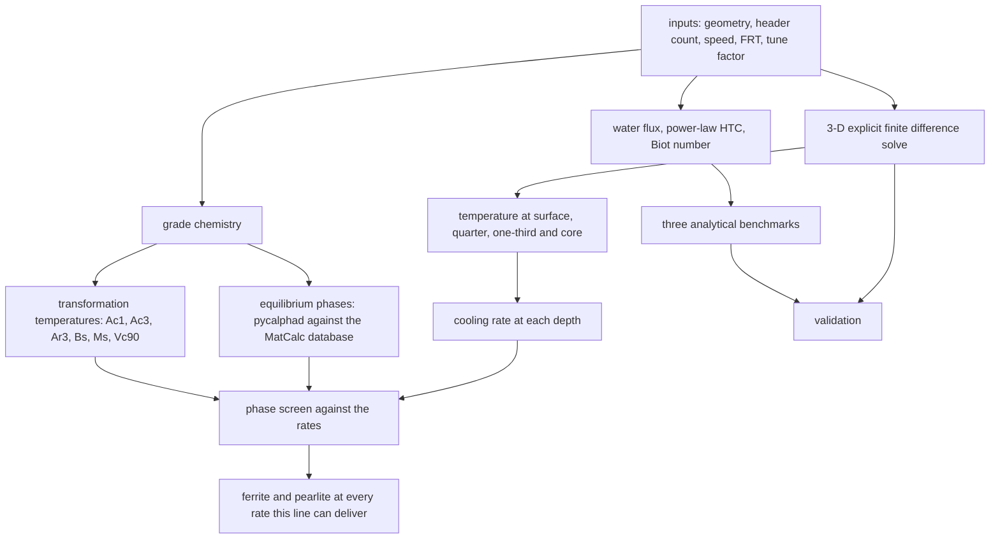

# Accelerated cooling simulation of a hot-rolled plate on a laminar cooling line

What happens to a plate between the finishing mill and the cooling bed: how far apart the surface,
quarter-depth, one-third-depth and core temperatures get while the water curtains pass, and how the plate
evens out afterwards.

That gap is what drives residual stress, flatness and property gradients through the thickness.

## What is here

```
ACC_Heat_Analysis.ipynb       the model, one cell per step, runs in a few minutes
ACC_Heat_Analysis.md          the same work as a write-up, with the equations and result tables
scripts/make_schematics.py    draws the two schematics below
figures/                      output of the default run, plus those schematics
```


The drawing uses a 1000 mm header spacing so a full bank fits in one picture; the default run is five
headers at 3000 mm. Half the width is solved by symmetry and the four depths are taken at the plate centre.

## The route



The chemistry decides the thresholds before the thermal model produces the rates, and the phases are read
where the two meet.

## How it works

Three stages. First an empirical module sizes the problem: water flux from the header flow and impingement
area, a heat transfer coefficient from a power law, the Biot number and three analytical estimates (lumped,
semi-infinite, Heisler). Biot comes out at 1.48, so the plate is not a lump and a field solution is needed.

Then a 3-D explicit finite difference solver resolves `T(thickness, width, length, t)` on a 26 x 201 x 241
grid with a stability-limited step of 0.061 s. The plate stays fixed and the curtains sweep over it: any
surface point within half an impingement length of a header sees the water coefficient, everything else sees
air convection and radiation as a single film coefficient.

A tuning factor calibrates the water side against a measured finish cooling temperature, because scale,
header pressure, curtain alignment and roughness all move the severity away from the textbook correlation.
The worked example recovers a measured 780 °C core from a predicted 820.5 °C with a factor of 2.12.

The metallurgy then reads the thermal result. The chemistry of the grade gives Ac1, Ac3, Ar3, Bs, Ms and the
rate that would leave 90 per cent martensite, and pycalphad with the MatCalc steel database gives the
equilibrium boundaries. It is a screen rather than a CCT diagram: a threshold makes a phase possible, it does
not say how much of it appears.

## Equations

Heat inside the plate, from the sources at the end:

$$\mathbf{q} = -k\nabla T, \qquad \frac{\partial T}{\partial t} = \alpha \nabla^2 T, \qquad \alpha = \frac{k}{\rho c_p} \qquad [1]$$

$k$ 30 W/m/K, $\rho$ 7850 kg/m³, $c_p$ 650 J/kg/K, so $\alpha$ is 5.88 × 10⁻⁶ m²/s.

At the surface, water while the point sits under a curtain and air plus radiation everywhere else:

$$-k\frac{\partial T}{\partial n} = h_w\,(T_s - T_w) \qquad [2]$$

$$-k\frac{\partial T}{\partial n} = h_{air}(T_s - T_\infty) + \varepsilon\sigma\left(T_s^4 - T_{amb}^4\right) \qquad [2]$$

$h_w$ 3548 W/m²K, $h_{air}$ 20, water and air both at 30 °C, $\varepsilon$ 0.8 for oxidised steel. The
symmetry plane at half width carries no flux.

The water side:

$$\dot W = \frac{Q_{header}/60}{W\,l_{imp}}, \qquad h_w = C\,\dot W^{\,n}, \qquad C = 1.2\times10^{4},\ n = 0.45$$

$\dot W$ is 66.7 L/m²/s: 2000 L/min per header spread over a 250 mm impingement band on a 2000 mm plate.
These two constants are the one place in the file with no source I can name. They came with the original
notebook rather than from a paper, so they are a starting calibration, and the tuning factor exists to
absorb the difference.

The dimensionless groups and the three analytical answers:

$$Bi = \frac{h_w\,(t_h/2)}{k}, \qquad \tau = \frac{\rho c_p (t_h/2)}{h_w}, \qquad T(t) = T_w + \left(T_{FRT} - T_w\right)e^{-t/\tau} \qquad [2]$$

$$T_s = T_{FRT} + \left(T_w - T_{FRT}\right)\left(1 - e^{b^2}\mathrm{erfc}\,b\right), \qquad b = \frac{h_w\sqrt{\alpha t}}{k} \qquad [1]$$

$$\zeta_1\tan\zeta_1 = Bi, \qquad \frac{T-T_w}{T_0-T_w} = C_1 e^{-\zeta_1^2 Fo}, \qquad Fo = \frac{\alpha t}{(t_h/2)^2} \qquad [3]$$

$Bi$ 1.48, $\tau$ 18.0 s, $t$ the 0.25 s under one curtain, $\zeta_1$ 0.9836. The first two are lower
bounds rather than brackets: both assume the water coefficient acts continuously while the plate is under
water for about a twentieth of the pass, so they over-predict the cooling and land below the solve. Lumped
252 °C, Heisler 437 °C, the solve 809 °C. The semi-infinite 758 °C is not a core temperature at all but a
surface dip during one 0.25 s curtain contact.

The time step is set before the run from the conduction limit and the tighter surface limit, scaled by 0.8
[4]. Radiation is folded into a film coefficient so the surface update stays linear in temperature:

$$h_{rad} = \varepsilon\sigma\left(T^2 + T_\infty^2\right)\left(T + T_\infty\right) \qquad [2]$$

Both temperatures in that factorisation are absolute. It is what $\varepsilon\sigma(T^4 - T_\infty^4)$
becomes, so evaluating it in °C rather than kelvin understates the coefficient several-fold: 32 W/m²K against
94 W/m²K at an 880 °C surface facing a 30 °C sink. The code adds 273.15 before it evaluates.

Cooling rate is what the metallurgy responds to:

$$CR = -\frac{dT}{dt}$$

Where the steel transforms:

$$Ac_1 = 739 - 22C - 7Mn + 2Si + 14Cr + 13Mo - 13Ni + 20V \qquad [7]$$

$$Ac_3 = 910 - 203\sqrt{C} - 15.2Ni + 44.7Si + 104V + 31.5Mo + 13.1W \qquad [6]$$

$$Ar_3 = 910 - 203\sqrt{C} - 30Mn + 44.7Si - 11Cr + 31.5Mo - 15.2Ni \qquad [6]$$

$$B_s = 830 - 270C - 90Mn - 37Ni - 70Cr - 83Mo, \qquad M_s = 561 - 474C - 33Mn - 17Cr - 17Ni - 21Mo \qquad [5]$$

$$\log_{10} V_{c90} = 2.94 - 0.75\beta, \qquad \beta = 2.7C + 0.4Si + Mn + 0.45Ni + 0.8Cr + 2Mo \qquad [9]$$

That is the boron-treated form. A boron-free steel, which is what this grade is, takes the same equation with
the 3.69 constant and half the molybdenum coefficient, and the notebook picks between the two from the
chemistry rather than assuming one.

Elements in weight per cent, taken from the chemistry cell (C 0.09, Mn 1.45, Si 0.25, Nb 0.035, Ti 0.015 for
the default grade). It gives Ac1 728, Ac3 861, Ar3 816, Bs 672, Ms 470 °C and Vc90 207 °C/s on this
boron-free chemistry. The Ar3 line is an Ae3-style expression rather than a published ferrite-start relation:
Andrews gave Ae3, Ac1 and Ac3 and no cooling-start form, and most of the gap between Ac3 and Ar3 here is the
manganese and chromium terms that appear in one and not the other rather than a heating and cooling
hysteresis.

The ferrite start line on the CCT map is the one relation here that carries the cooling rate itself, with
the coefficient at 0.084 per °C/min [8]. Over the fitted band of 10 to 200 °C/min that is the 25 °C decrease
the paper reports, where the 0.0084 printed in the handbook compilation [14] would give under 2 °C. The line is
drawn only over that band, and where a rate leaves it the cell says so instead of quoting a temperature.

The equilibrium annex minimises

$$\min G(T, x) \quad \text{over} \quad \{\gamma, \alpha, Fe_3C, M_{23}C_6, M_7C_3, M_6C\} \qquad [10]$$

with pycalphad [11] against the MatCalc steel database [12], [13]. The set carries no niobium, titanium or
vanadium carbide or nitride, so the calculation leaves the whole of those additions in solution by construction
and says nothing about precipitation. Equilibrium has nothing to say about how long a transformation takes
either, which is why it only sets thresholds.

## Default run

25 mm thick, 2000 mm wide, 12000 mm long, five curtains per side at 3000 mm, 60 m/min, FRT 880 °C.

- Core falls from 880 to 809 °C over 24.1 s of cooling, then the plate air-cools for 30 s, ending near
  773 °C.
- The surface-to-core gap peaks near 137 °C while the curtains pass and is down to about 21 °C on the bed.
- Rates: about 673 °C/s at the surface under a curtain, 3.0 to 3.8 °C/s over the pass, 0.96 to 1.19 °C/s on
  the bed. For this chemistry that is ferrite and pearlite; bainite would need the plate at 672 °C at a rate
  this line never reaches.
- Lumped 252 °C and Heisler 437 °C sit below the field solve, which is what a lower bound should do.

The full write-up, with the input tables and every figure, is in `ACC_Heat_Analysis.md`.

## Methods

- numpy for the fields, the vectorised curtain mask and the analytical solutions; matplotlib for the twelve
  figures, written to `figures/` by the notebook.
- Explicit finite difference on 26 x 201 x 241 with a stability-limited step, chosen over a commercial solver
  because the moving curtain and the through-thickness sampling are easy to write directly and to check.
- pycalphad with the MatCalc mc_fe v2.062 database (ODbL, TU Wien) for the equilibrium annex. It needs
  Python 3.13 or older, since there is no `symengine` wheel for 3.14 yet, and the database is fetched at
  first use rather than committed.
- nbconvert to execute the notebook headlessly, so the outputs that ship are the result of a run.

## Run it

[](https://colab.research.google.com/github/daniswaramp/steel-plate-cooling-fdm/blob/main/ACC_Heat_Analysis.ipynb)

Colab has numpy and matplotlib, which is all the thermal model needs. Locally:

```bash
pip install -r requirements.txt
jupyter notebook ACC_Heat_Analysis.ipynb
```

Change the process inputs and the chemistry in the inputs cell and re-run. The equilibrium annex is the one
part that needs `pycalphad`, which currently wants Python 3.13 or older, and it fetches the MatCalc database
into `databases/` on first use. Without it the rest runs and that cell reports that the annex was skipped.

## Scope

Constant thermal properties, no latent heat, boiling through a toggle rather than a boiling curve, no scale
layer. Those are the three places a plant measurement would diverge most, which is what the tuning factor
absorbs. Read the numbers as a method demonstration on plausible plate-mill conditions, not as a statement
about any particular line.

## References

[1] H. S. Carslaw and J. C. Jaeger, *Conduction of Heat in Solids*, 2nd ed. Oxford, U.K.: Oxford Univ. Press, 1959.

[2] T. L. Bergman, A. S. Lavine, F. P. Incropera, and D. P. DeWitt, *Fundamentals of Heat and Mass Transfer*, 8th ed. Hoboken, NJ, USA: Wiley, 2018.

[3] M. P. Heisler, "Temperature charts for induction and constant-temperature heating," *Trans. ASME*, vol. 69, pp. 227-236, 1947.

[4] J. Crank, *The Mathematics of Diffusion*, 2nd ed. Oxford, U.K.: Oxford Univ. Press, 1975.

[5] W. Steven and A. G. Haynes, "The temperature of formation of martensite and bainite in low-alloy steels. Some effects of chemical composition," *J. Iron Steel Inst.*, vol. 183, pp. 349-359, 1956.

[6] K. W. Andrews, "Empirical formulae for the calculation of some transformation temperatures," *J. Iron Steel Inst.*, vol. 203, pt. 7, pp. 721-727, 1965.

[7] H. Brandis, "Rechnerische Bestimmung der Umwandlungstemperaturen von niedriglegierten Stählen," *TEW Tech. Ber.*, vol. 1, no. 1, pp. 8-10, 1975.

[8] B. Mintz, J. R. Banerjee, and K. M. Banks, "Regression equation for Ar3 temperature for coarse grained as cast steels," *Ironmaking & Steelmaking*, vol. 38, no. 3, pp. 197-203, 2011.

[9] M. Ueno and K. Itoh, "New empirical formula for estimation of hardenability from chemical compositions," *Tetsu-to-Hagané*, vol. 74, no. 6, pp. 1073-1080, 1988.

[10] L. Kaufman and H. Bernstein, *Computer Calculation of Phase Diagrams*. New York, NY, USA: Academic Press, 1970.

[11] R. Otis and Z.-K. Liu, "pycalphad: CALPHAD-based computational thermodynamics in Python," *J. Open Res. Softw.*, vol. 5, no. 1, p. 1, 2017, doi: 10.5334/jors.140.

[12] E. Povoden-Karadeniz and A. Jacob, "MatCalc steel database mc_fe, version 2.062," TU Wien, Vienna, Austria, 2024, Open Database Licence. [Online]. Available: https://www.matcalc.at

[13] A. Moolya, "PyCalphad-compatible port of the MatCalc mc_fe v2.062 steel database," 2026. [Online]. Available: https://github.com/adityamoolya/maraging-steel-calphad (renamed to maraging-steel-calphad-dft since; the notebook's original URL still redirects).

[14] A. A. Gorni, *Steel Forming and Heat Treating Handbook*, 27 September 2024 ed. [Online]. Available: http://www.gorni.eng.br/e/Gorni_SFHTHandbook.pdf. A compilation of the transformation-temperature regressions used here, cited where its transcription differs from the paper it reprints.
